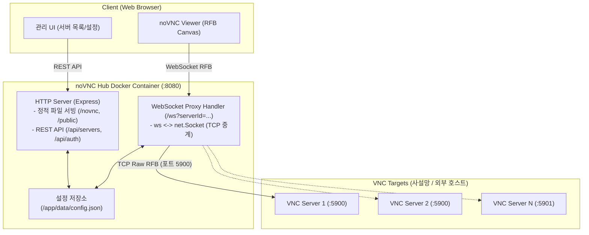

# noVNC Hub (가칭) 시스템 설계서

## 1. 프로젝트 개요
- **목적**: 웹 브라우저에서 다수의 VNC 서버를 등록/선택하여 손쉽게 접속할 수 있는 초경량 Web VNC 포털 솔루션.
- **주요 특징**:
  - 단일 Docker 컨테이너 및 단일 포트 서비스 (관리 UI + noVNC 뷰어 + WebSocket 프록시 올인원).
  - UI 상에서 서버 등록/수정/삭제 (CRUD) 및 로그인 설정 지원.
  - 외부 DB 없이 로컬 파일(`data/config.json`)을 통한 간편한 설정 영속화 및 백업.

---

## 2. 백엔드 기술 스택 검토 (Node.js vs Python)

| 비교 항목 | Node.js (Express + ws) ⭐ **최종 추천** | Python (FastAPI + aiohttp/websockets) |
| :--- | :--- | :--- |
| **noVNC 라이브러리 연동** | npm 패키지(`@novnc/novnc`)로 noVNC 공식 모듈을 직접 버전 고정 관리 가능 | git 서브모듈 또는 static 파일 직접 다운로드 관리 필요 |
| **WebSocket ↔ TCP 소켓 프록시** | Node.js의 기본 Stream 파이핑(`ws` + `net.Socket`)으로 백프레셔 및 대용량 화면 스트리밍을 단일 이벤트 루프에서 최고 효율로 처리 | `asyncio.open_connection` 등으로 비동기 태스크 릴레이 구현 필요 (상대적으로 코드 복잡도 증가) |
| **단일 컨테이너 리소스** | 메모리 사용량 낮음 (~30-50MB), 초경량 Alpine 이미지 구성 용이 | Slim/Alpine 이미지 가능하나 패키지 크기가 상대적으로 큼 (~100MB+) |
| **언어/스택 일관성** | 프론트엔드(JavaScript)와 백엔드(Node.js) 단일 언어로 유지보수 용이 | 프론트(JS)와 백엔드(Python)로 언어 분리 |

> **선정 결과: Node.js (v20-alpine 기반)**  
> noVNC 자체가 JavaScript 생태계이고, WebSocket과 VNC TCP 소켓 간의 고속 양방향 프록시 스트리밍 구현에 Node.js 스트림 모델이 가장 안정적이고 가볍기 때문에 **Node.js**를 최종 스택으로 선정합니다.

---

## 3. 시스템 아키텍처



---

## 4. 데이터 저장소 및 스키마 설계 (`/conf.d/novnc-hub/config.json`)

별도 DB 없이 마운트된 디렉터리의 단일 JSON 파일로 모든 상태를 관리합니다.

```json
{
  "auth": {
    "enabled": false,
    "passwordHash": ""
  },
  "servers": [
    {
      "id": "srv-1",
      "name": "Ubuntu 데스크톱 (개발용)",
      "host": "192.168.1.10",
      "port": 5900,
      "password": "",
      "description": "GPU 개발 머신",
      "createdAt": "2026-10-02T07:00:00.000Z"
    },
    {
      "id": "srv-2",
      "name": "Windows 테스트 서버",
      "host": "192.168.1.20",
      "port": 5900,
      "password": "encrypted_or_plain",
      "description": "QA 테스트용",
      "createdAt": "2026-10-02T07:05:00.000Z"
    }
  ]
}
```

- **안전성**: UI에서 변경 시 `config.json.tmp`에 쓴 뒤 원자적(atomic) rename으로 파일 손상 방지.
- **초기화**: 파일이 없으면 기본 템플릿(로그인 비활성화 상태)으로 자동 생성.

---

## 5. API 및 WebSocket 프록시 명세

### 1) REST API
- `GET /api/status`: 인증 활성화 여부 및 현재 로그인 상태 확인
- `POST /api/auth/login`: 마스터 패스워드 로그인 (세션 쿠키 발급)
- `POST /api/auth/logout`: 로그아웃
- `PUT /api/auth/settings`: 로그인 기능 ON/OFF 및 마스터 비밀번호 변경
- `GET /api/servers`: 등록된 서버 목록 반환 (비밀번호 제외)
- `POST /api/servers`: 신규 서버 추가
- `PUT /api/servers/:id`: 서버 정보 수정
- `DELETE /api/servers/:id`: 서버 삭제
- `GET /api/servers/:id/ping`: 대상 VNC 포트 TCP 핑/헬스체크 (온라인/오프라인 상태 표시용)

### 2) WebSocket 프록시 (`/ws?serverId={id}`)
- 클라이언트가 WebSocket으로 접속하면 서버는 `/conf.d/novnc-hub/config.json`에서 `serverId`에 해당하는 `host`와 `port`를 조회.
- Node.js `net.createConnection({ host, port })`를 생성하여 WebSocket과 TCP 소켓 간 바이너리 데이터 상호 릴레이.
- 만약 서버에 VNC 패스워드가 등록되어 있다면, noVNC 클라이언트가 접속 시 자동으로 인증 파라미터를 넘길 수 있도록 지원(또는 수동 입력).

---

## 6. UI/UX 화면 구성

1. **메인 대시보드 (`/`)**:
   - 상단: 서비스 타이틀, 검색창, [서버 추가] 버튼, [설정] 버튼.
   - 중앙: 등록된 서버 카드 그리드.
     - 서버 이름, 호스트:포트, 설명, 실시간 온라인/오프라인 상태 뱃지.
     - [접속하기] 버튼, [수정], [삭제] 액션 메뉴.
2. **noVNC 뷰어 화면 (`/viewer.html?id={id}`)**:
   - 상단 플로팅 툴바 (자동 숨김 가능):
     - `[< 목록으로]` 뒤로가기 버튼
     - 서버 전환 드롭다운 (다른 서버로 즉시 스위칭)
     - `Ctrl+Alt+Del` 전송 버튼
     - 화면 배율 조절 (Scale / Fit to Screen)
     - 전체화면 토글
   - 메인 화면: noVNC RFB 캔버스.
3. **설정 모달 / 탭**:
   - 기본 로그인 보호 활성화/비활성화 토글.
   - 마스터 패스워드 설정 및 변경.

---

## 7. 배포 및 Docker 구성

### 디렉터리 구조
```text
novnc/
├── Dockerfile
├── docker-compose.yml
├── package.json
├── DESIGN.md
├── src/
│   ├── server.js          # Express + WebSocket + TCP 프록시
│   ├── config.js          # JSON 파일 I/O 관리 (/conf.d/novnc-hub/config.json)
│   └── routes/
│       ├── api.js         # REST API 엔드포인트
│       └── proxy.js       # WebSocket-TCP 브릿지
├── public/                # 프론트엔드 UI
│   ├── index.html         # 메인 대시보드 및 설정 모달
│   ├── viewer.html        # noVNC 뷰어 화면
│   ├── css/
│   │   └── style.css
│   └── js/
│       ├── app.js
│       └── viewer.js
```

### Docker 실행 방식
```bash
docker run -d \
  --name novnc-hub \
  -p 8080:8080 \
  -v $(pwd)/config:/conf.d/novnc-hub \
  --restart unless-stopped \
  novnc-hub
```
